# Krea Studio

**Walk through a text-to-image model while it draws: every block, every head, every neuron, in 3D.**

One **real** generation by the Krea 2 diffusion transformer (28 blocks, 48 heads, 16384-neuron MLPs), recorded from
the real model with its real weights and replayed in Godot 4.7, from the prompt to the picture. Nothing is simulated.

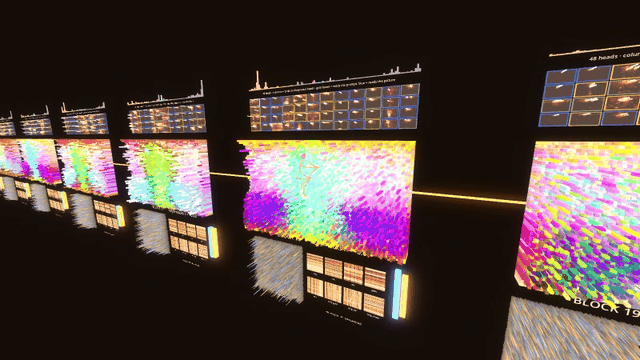

A [Reasoning School Research](https://reasoning.school/research/) project by Ashwin Venkat.

## The problem this started from

Ask a text-to-image model for the same character doing something else ("waving" → "holding a book"), keep the seed,
and **the character stays almost the same but the background changes every time**: the desks move, the shelves
change, the window jumps. That breaks any story, lesson or animation made of several pictures.

This is independent work on why that happens and how to fix it, without training anything:
1. **The first words are the anchor.** The character is described first; every image patch that pays attention to
   those words is the character. That attention map *is* a person mask (IoU 0.75–0.77 with a background remover),
   no segmentation model needed.
2. **The background is the part nobody anchors.** Patch-by-patch change between two pictures correlates with
   attention to the *action* words (+0.50), not the character (+0.13) or the scene words (+0.08).
3. **Fix: copy the background's keys and values** from picture A into picture B, using that attention mask.
   Background change dropped from **25.1/255 (27 % of pixels) to 1.0–1.3/255 (0.2–0.5 %)**, and the new pose was kept.

Related published work arrived at similar ideas (KV-Edit, CharaConsist, Self-Guidance; see below); this repo is an
independent path to it, plus the tools to *see* why it works.

Krea Studio grew out of that: once you can see attention, you start forming the next hypothesis.

## What the studio shows

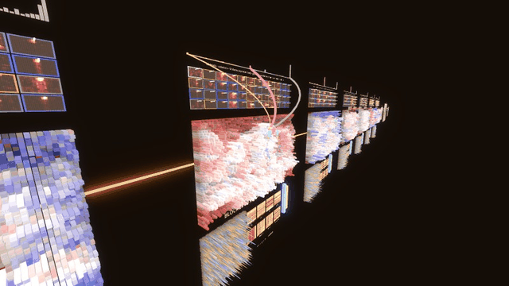

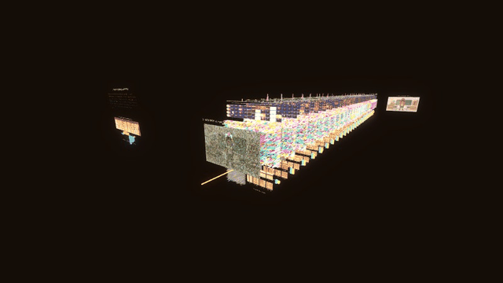

| | |
|---|---|
| 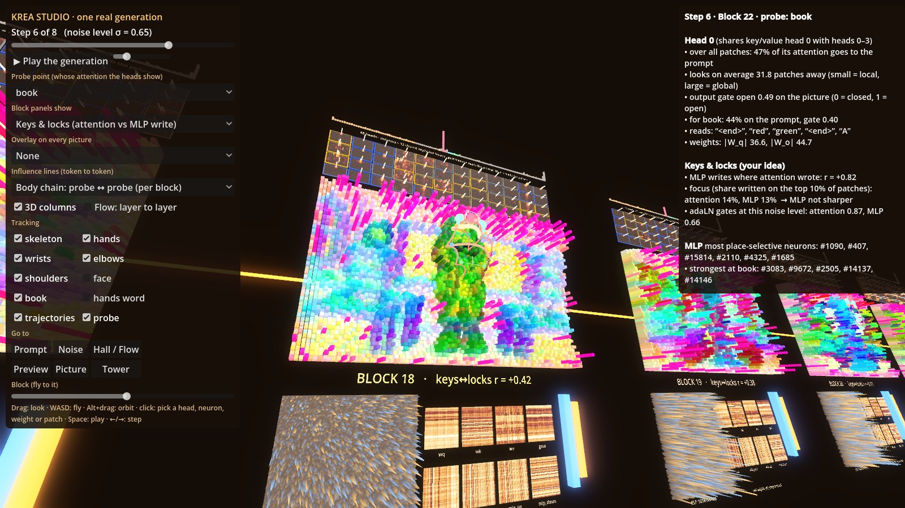 | 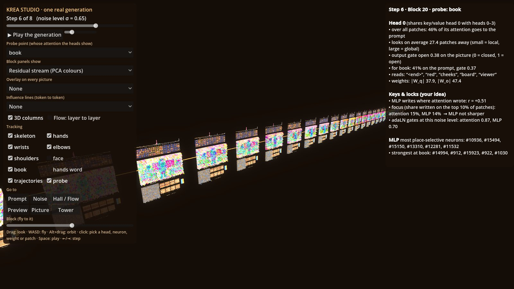 |
| 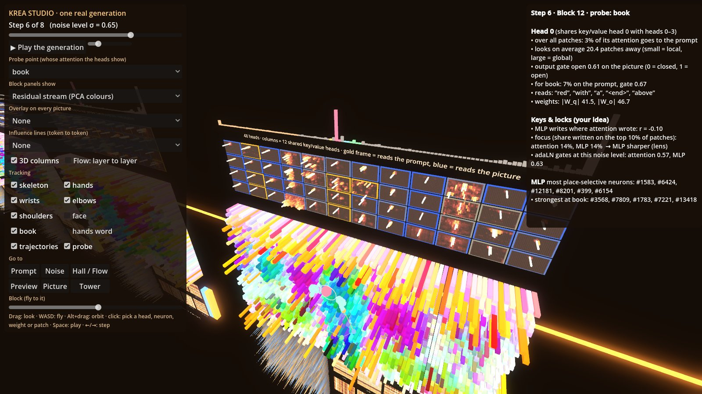 | 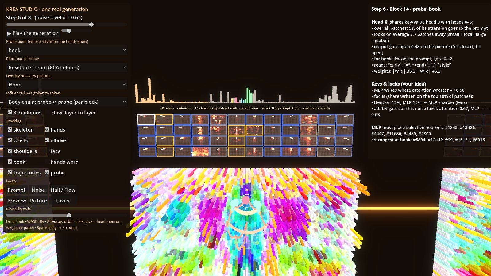 |
| 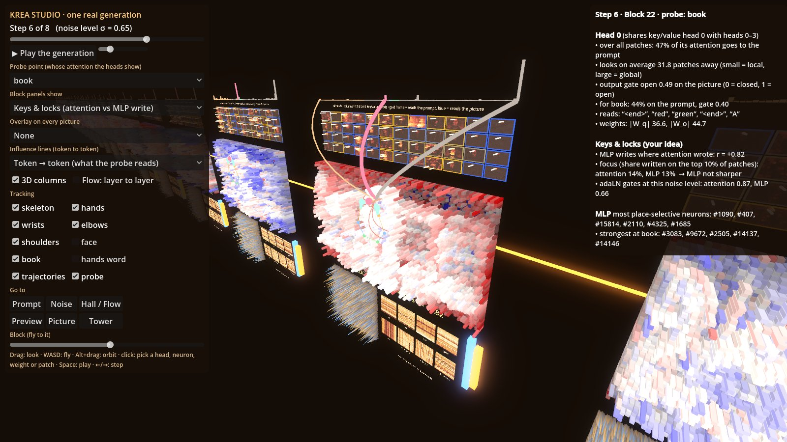 | 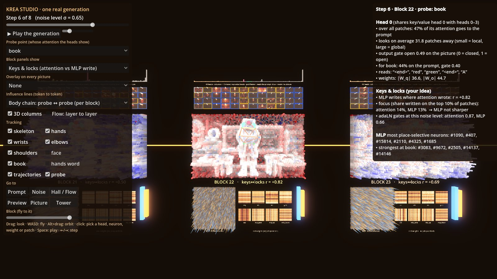 |
| 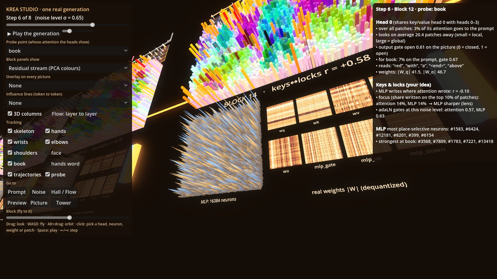 | 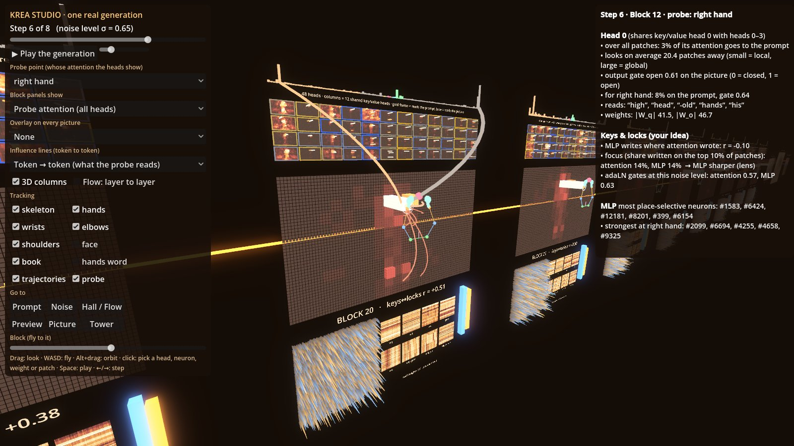 |
| 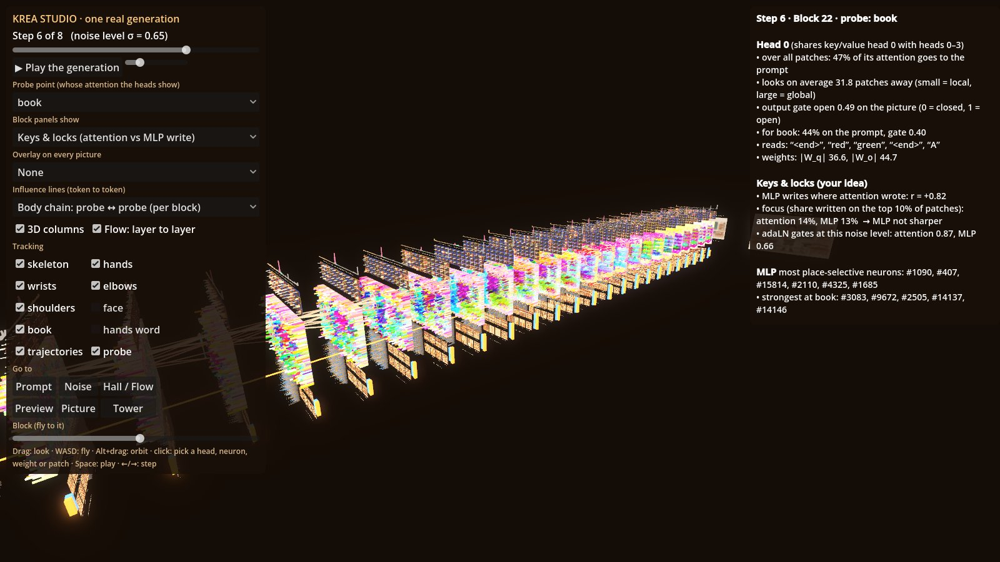 | 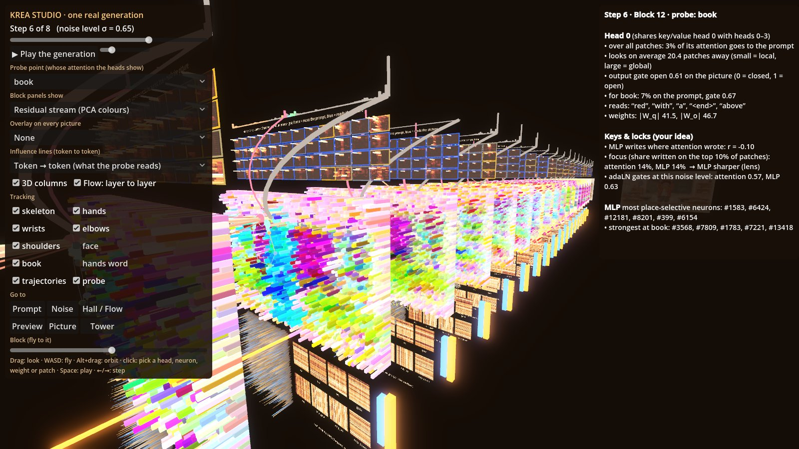 |
|  | 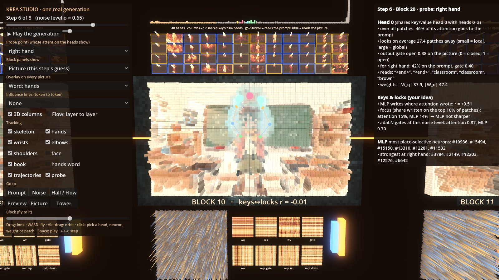 |
| 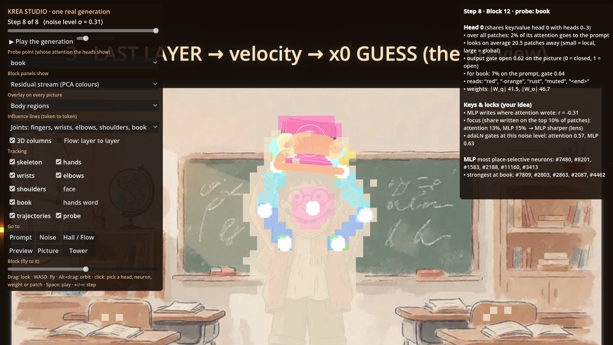 | 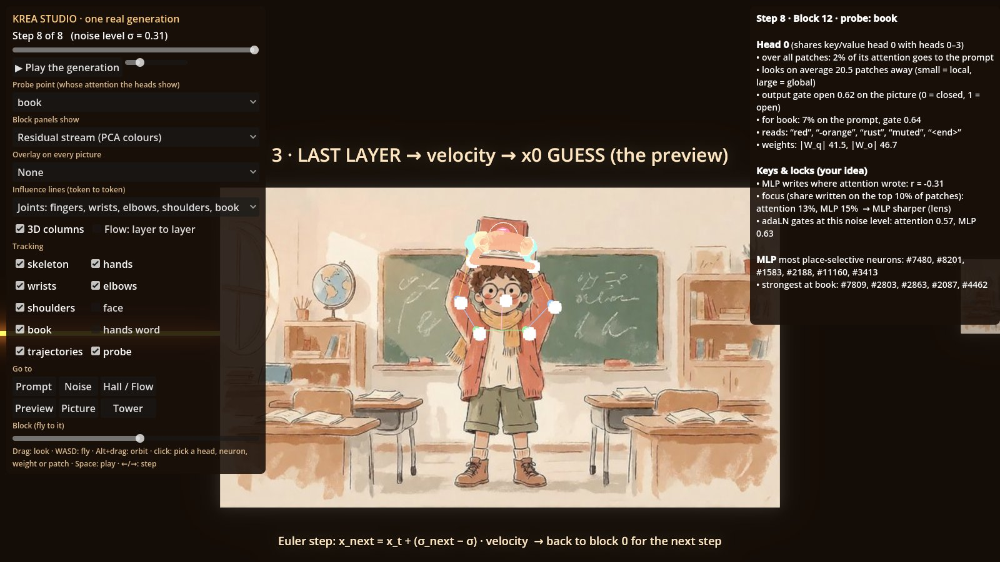 |
| 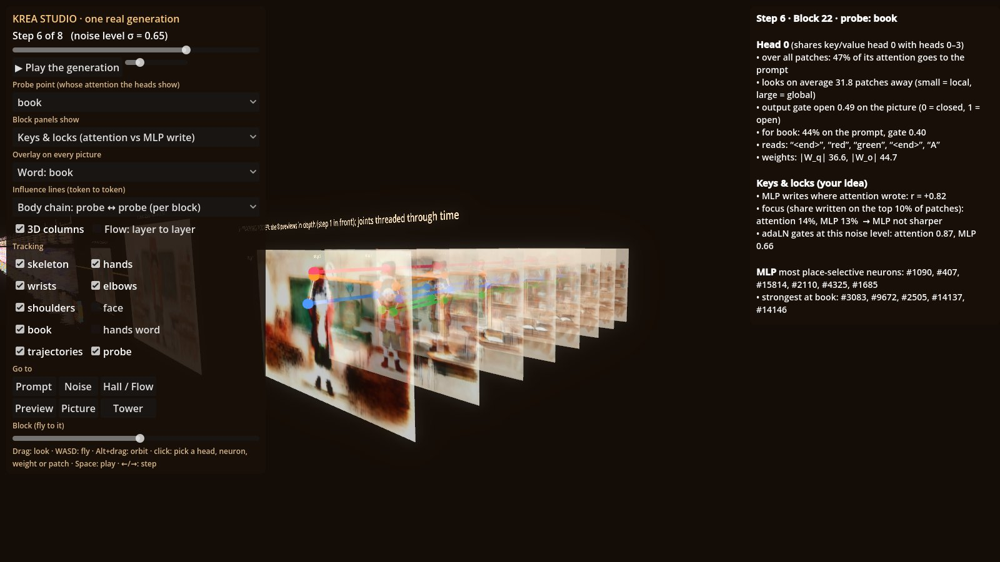 | 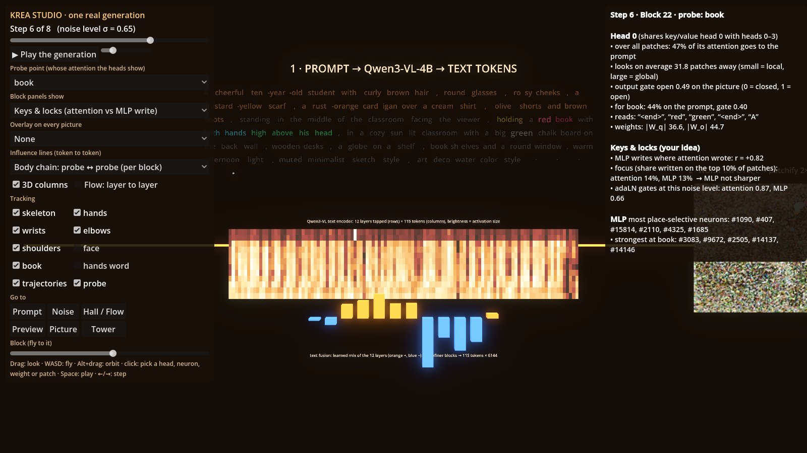 |
| 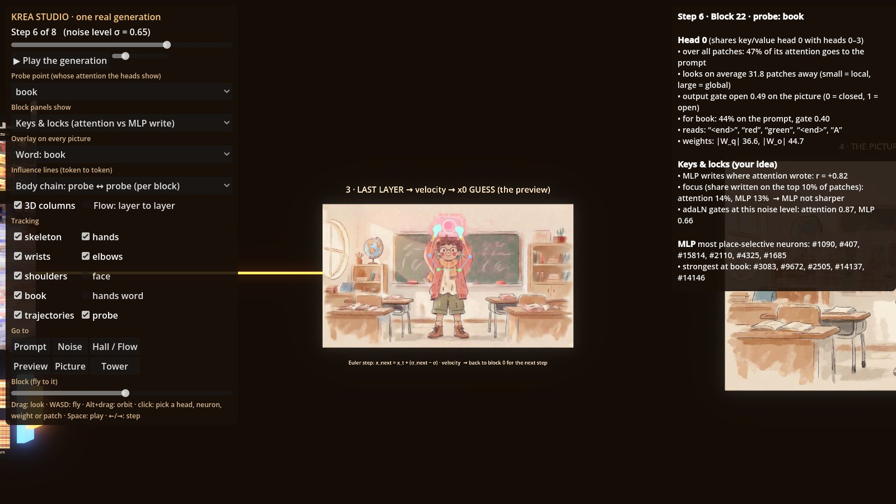 | 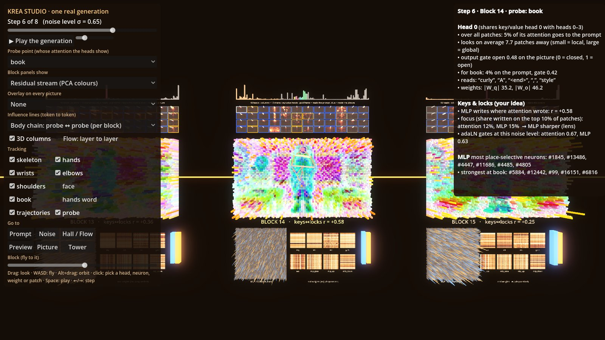 |

### The hall, left to right = the computation
1. **Prompt** → Qwen3-VL-4B (12 layers tapped) → text fusion (its real learned 12-layer mix) → 115 text tokens,
   glowing by how much the selected head reads them.
2. **Noisy input x_t** → 2×2 patches → 48 × 84 = 4032 image tokens.
3. **28 single-stream blocks**, each with: the big panel (pick a view), **all 48 heads** (12 columns = the 12 shared
   key/value heads, 4 query heads each; every tile is that head's attention heat map), what the probe reads in the
   prompt, the 16384-neuron **MLP**, the **real weights** (dequantized |W|), and the adaLN gates.
4. **Preview**: velocity → the model's guess of the final picture at this step → the Euler step → back to block 0.
5. **The picture** after 8 steps. 6. **Tracking tower**: the 8 previews in depth, joints threaded through time.

**Views**: residual stream (PCA colours), token size, **keys & locks** (attention write vs MLP write), attention write,
MLP write, probe attention, selected head, selected neuron, the picture. **Overlays**: word maps, body regions,
background, clicked-patch attention. **Tracking**: skeleton, 21 hand points each, wrists, elbows, shoulders, face, book.
**3D columns**, **Flow: layer to layer**, and **influence lines** token to token (what a patch reads, the body chain
per block, joints linked by attention).

## Run it

You only need [Godot 4.7](https://godotengine.org/download) (no GPU, no model; the recording is in `data/`):

```bash
git clone https://github.com/researchase/krea-studio
godot --path krea-studio
```

Drag = look, WASD = fly, Alt+drag = orbit, click = pick a head, neuron, weight or patch, Space = play, ←/→ = step.
`godot --path . -- --shot=DIR` saves a screenshot tour; `-- --anim=DIR` records the README animations.

## The pipeline, end to end: what is shown and how deep
| Stage | In the studio |
|---|---|
| Prompt → tokens | all 115 tokens, coloured by word group, lit by what the selected head reads |
| Qwen3-VL-4B text encoder | the 12 tapped layers as a token × layer activation grid (its internals are not opened) |
| Text fusion | its real learned 12-layer mix (the 2 refiner blocks are not shown separately) |
| Noise x_t → 2×2 patches → 4032 tokens | the noisy input of every step |
| **28 single-stream blocks** | **fully**: residual stream, 48 heads, gates, attention/MLP writes, 16384 neurons, adaLN, real weights |
| Last layer → velocity → x0 guess | the preview at every step |
| Euler step × 8 | step slider / play; the tracking tower shows all 8 |
| VAE decode → picture | the final picture (the VAE decoder's internals are not opened) |

## Findings so far (one model, small samples: hypotheses, not laws)
- **Background lock** works: 25.1/255 → 1.0/255 background change by copying background K/V (above).
- **Arms behave like inverse kinematics** (16 pictures, book at four heights): as the book rises the wrist moves
  0.80×, the elbow 0.38×, the shoulder ~0 (fixed anchor). Elbow angle 144° → 89° → 37° → 121° (waist → chest → face
  → above the head): the IK curve of a two-bone arm.
- **Attention is a chain**: book ↔ hands ↔ forearm ↔ upper arm ↔ shoulder, each part reading its neighbours; at equal
  distance body parts get 3–28× the attention background patches get; left and right limbs are mirror-coupled.
- **Lead and lag**: the book/hand group is decided at step 1 (r 0.96), both ends of the arm lock first and the
  elbow is solved last (step 3); pushing a moved hand+book group for the first 4 of 8 steps moves the arm cleanly.
- **Keys & locks** (MLP writing where attention wrote): weak in early blocks (r ≈ 0), strong late (r 0.6–0.8);
  the MLP is barely more focused than attention. Co-location only, not yet proof of a lock-and-key mechanism.

## How the data was made
1. `tools/capture/rs_capture_node.py`: a ComfyUI node (`RSCapture`) hooking the real Krea 2 model: every block,
   attention per head for 10 probe points, MLP, gates, dequantized weights.
2. `tools/capture/studio_capture.py`: one generation (Krea 2 Turbo int8 + warm-pastel and soft-watercolour style
   LoRAs, 1344×768, 8 steps, seed 23); decodes x_t and the x0 guess of every step.
3. `tools/export_data.py`: packs it, plus SDPose tracking of each step, into `data/`.

## Honest limits
- Head attention is recorded for 10 probe points (book, hands, elbows, a shoulder, face, chest, wall, floor);
  "clicked patch" attention for any patch is a mean over heads of blocks 4/10/16/22 (top 32 cells).
- Head maps are pooled to 4×4-patch cells; neuron maps exist for each block's 16 most place-selective neurons.
- Weight thumbnails are the dequantized int8 base weights (style LoRAs not merged), reproducing the layers to 8–18 %.
- SDPose finds no confident joints in the blurriest first steps, so tracks start at step 2–3.

## Roadmap
- Type a prompt in the studio, generate on your own GPU, see the picture, and **lock the background**.
- A small standalone Python backend, so capture does not need the ComfyUI app.

## Credits
- Idea, hypotheses and direction: **Ashwin Venkat**, Reasoning School (formerly Researchase).
- Built with Claude Code (Anthropic).
- Model: **Krea 2** by Krea (not included here; its own licence applies). Text encoder: Qwen3-VL-4B.
  Run through [ComfyUI](https://github.com/comfyanonymous/ComfyUI). Pose: SDPose. Engine: [Godot](https://godotengine.org).
- Related work: KV-Edit (arXiv 2502.17363), CharaConsist (2507.11533), BachVid (2510.21696),
  One-Prompt-One-Story (2501.13554), Self-Guidance (Epstein et al., NeurIPS 2023).

## Licence
MIT © 2026 Ashwin Venkat, Reasoning School (OPC) Pvt Ltd. If you use this, please credit
"Krea Studio by Ashwin Venkat, Reasoning School".
